<div align="center">

# AI Product Studio

**AI-powered e-commerce content management and catalog automation built with Laravel and Google Gemini.**


[Features](#features) · [Screenshots](#screenshots) · [Architecture](#architecture) · [Quick start](#quick-start) · [Demo mode](#demo-mode) · [API](#rest-api) · [Tests](#tests) · [Security](#security) · [Limitations](#limitations)

</div>

Merchants describe a product once, get reviewable multilingual content from Gemini, and send only approved text to their store. Every AI result waits for a person, every store write is previewed field by field, and the whole workflow can be evaluated without any third-party credentials.

## Features

The last column says how each feature has actually been exercised. [Limitations](#limitations) defines the terms.

| Feature | What it does | Verified by |
| --- | --- | --- |
| AI product creation | Turns a plain-language description into structured product fields, keeping SKU and material only if the user wrote them | Real Gemini, automated tests |
| AI content generation | Titles, descriptions, SEO metadata, slug and keywords, as schema-constrained JSON | Real Gemini, automated tests |
| Languages | English, Albanian and German, one current version per language | Real Gemini, automated tests |
| Prompt settings | Tone, audience, length, style and delimited custom instructions | Automated tests |
| SEO analysis | Deterministic 100-point checklist with no AI call, plus factual consistency checks | Automated tests |
| Content approval | Drafts stay separate from saved content until approved, and replacing content needs confirmation | Automated tests |
| Bulk AI generation | Queued, rate-paced batches that feed Content Review | Automated tests |
| CSV and Excel | Column mapping, preview, duplicate handling, and export | Automated tests |
| WooCommerce | Import, field-level sync preview, conflict detection, rollback | **Simulated only** |
| WooCommerce Demo Mode | The same pipeline against a local simulated store | Automated tests, browser |
| REST API | Versioned, Sanctum tokens with abilities, async generation, idempotent writes, OpenAPI | Automated tests, local HTTP run with a Gemini stand-in |
| Subscriptions | Four plans, central entitlements, atomic monthly usage metering | Automated tests, MySQL concurrency run |
| Demo Billing Mode | Plan changes and payment states with no payments | Automated tests, browser |
| Stripe billing | Cashier Checkout, webhooks, invoices, Customer Portal | **Simulated only** |
| Shopify | **Not implemented.** Shown as Coming Soon in the app | None |

## Screenshots

Captured from the running application with fictional data. The AI text in the *SEO Analyzer* image came from a local stand-in for Gemini, not from the real service.

<table>
  <tr>
    <td width="50%">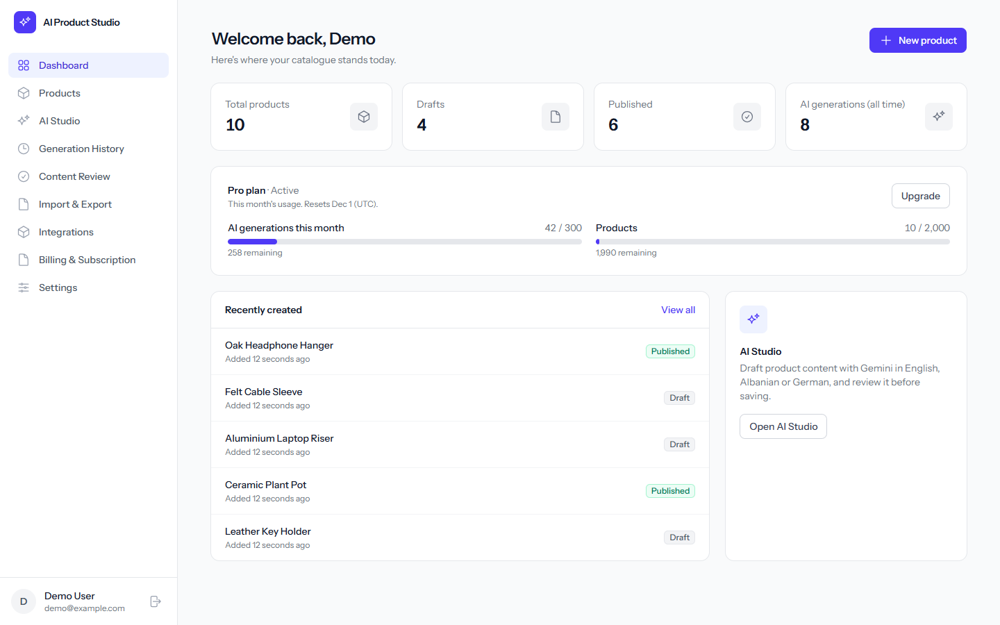<br><sub><b>Dashboard</b></sub></td>
    <td width="50%">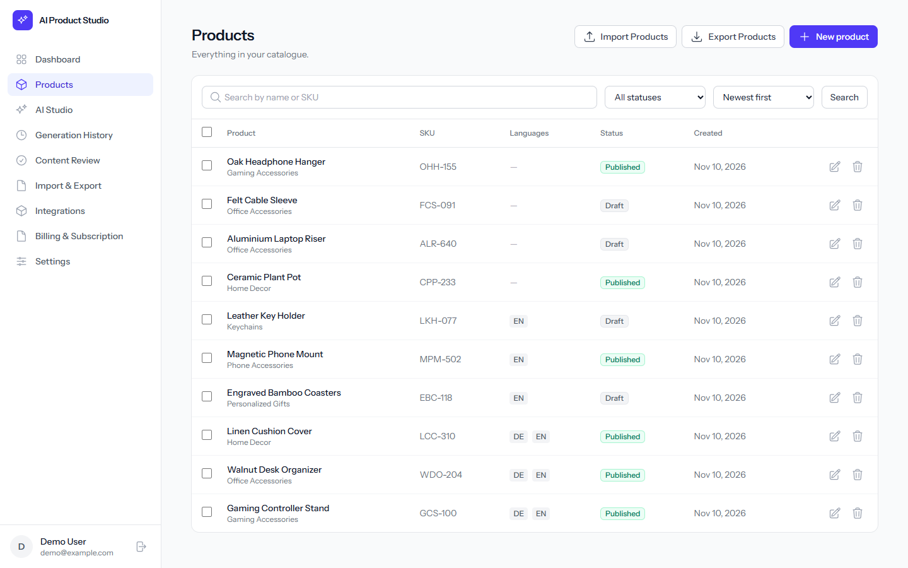<br><sub><b>Product management</b></sub></td>
  </tr>
  <tr>
    <td>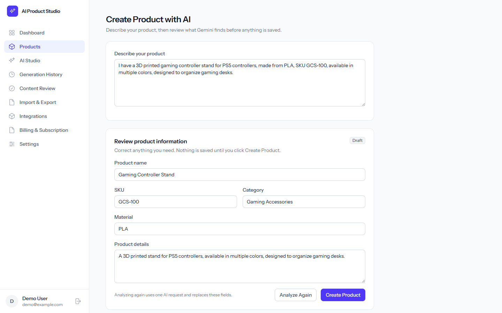<br><sub><b>AI product creation</b></sub></td>
    <td>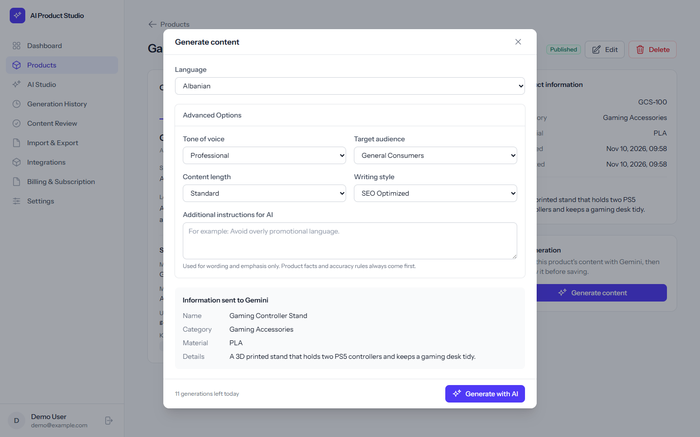<br><sub><b>Gemini generation options</b></sub></td>
  </tr>
  <tr>
    <td>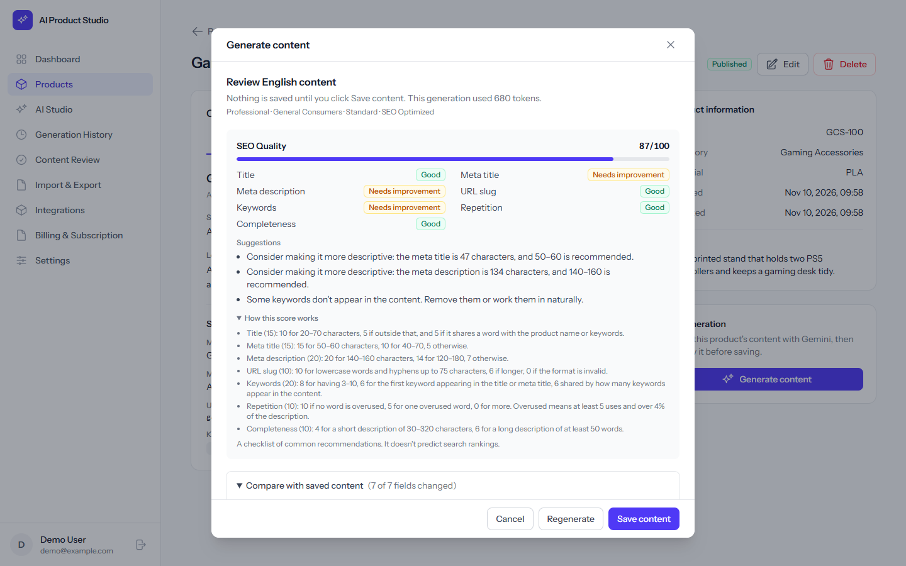<br><sub><b>SEO analyzer</b></sub></td>
    <td>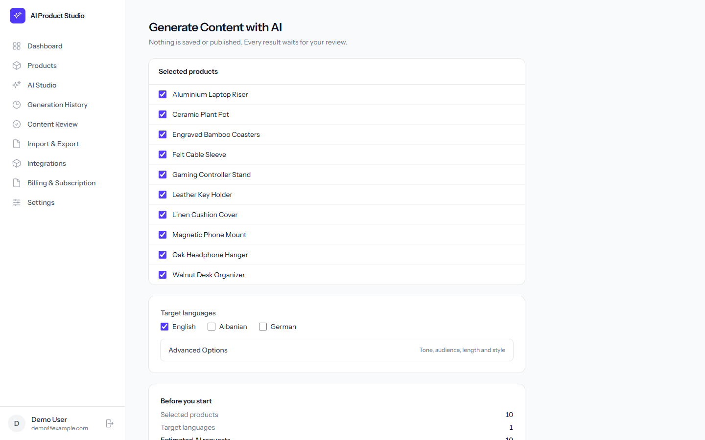<br><sub><b>Bulk AI generation</b></sub></td>
  </tr>
  <tr>
    <td>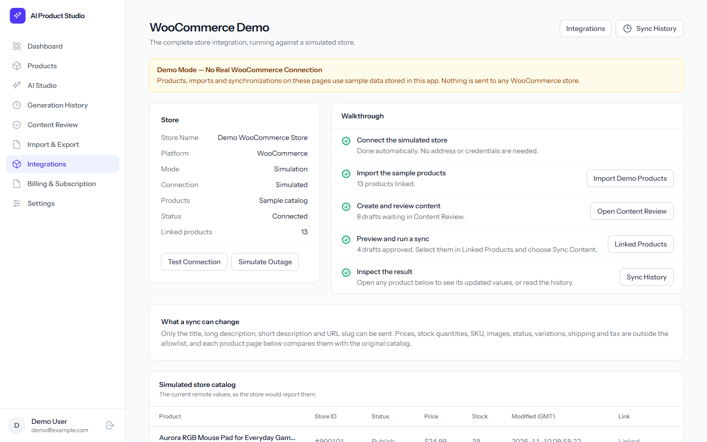<br><sub><b>WooCommerce Demo Mode</b></sub></td>
    <td>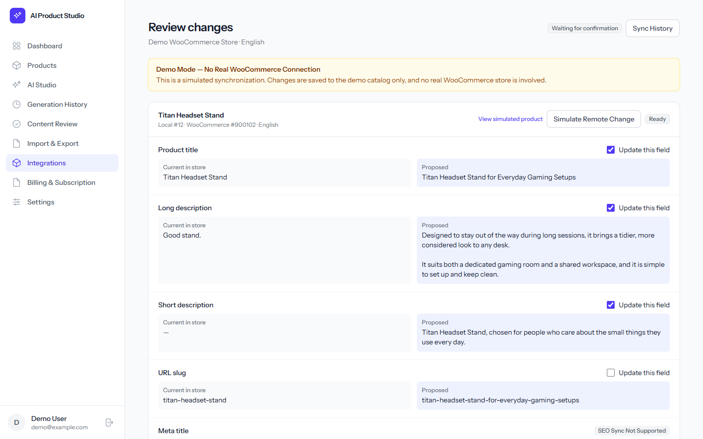<br><sub><b>Field-level sync preview</b></sub></td>
  </tr>
  <tr>
    <td>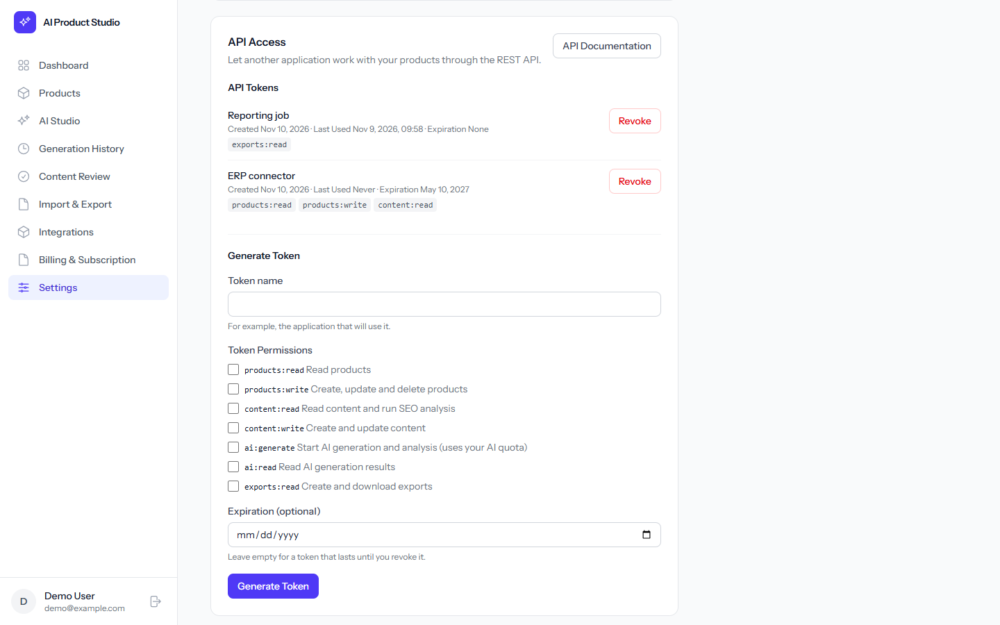<br><sub><b>API access</b></sub></td>
    <td>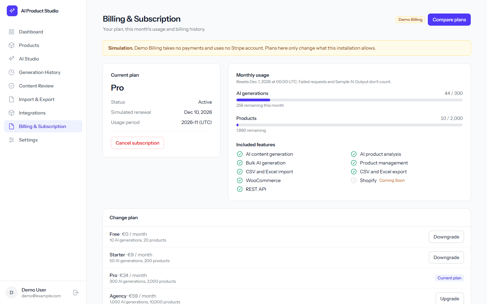<br><sub><b>Billing dashboard</b></sub></td>
  </tr>
</table>

## Architecture

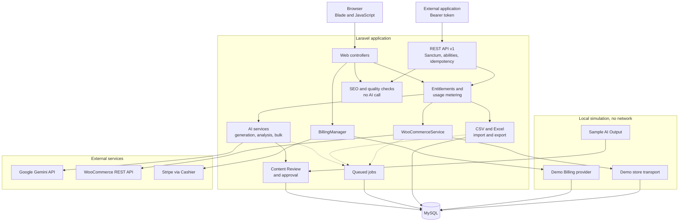

The transport and billing provider are chosen from server-side state, never from a request. See the [architecture guide](docs/architecture/README.md) for the design decisions.

## Quick start

You need PHP 8.3, Composer, Node.js 20.19 or newer, and an empty MySQL database named `ai_product_studio`.

```bash
git clone https://github.com/mirjetazymeri/ai-product-studio.git
```

```bash
cd ai-product-studio
```

```bash
composer run setup
```

```bash
php artisan serve
```

Open <http://localhost:8000> and register. No API keys are needed to evaluate the app through demo mode. To run bulk generation or API jobs, start a worker in a second terminal:

```bash
php artisan queue:work
```

The [installation guide](docs/setup/INSTALLATION.md) covers configuration, Gemini and Laragon.

## Demo mode

| Area | Without credentials | With credentials |
| --- | --- | --- |
| WooCommerce | Simulated store with sample products, sync, conflicts and reset | A real store with a REST API key |
| AI text | *Sample AI Output*: fixed text, always labeled, never presented as Gemini's | Real Gemini generation |
| Billing | Demo Billing with simulated plans and payment failures | Stripe, after setup |
| Gemini-only features | Show a clear "not set up" message | Work normally |

Follow the [demo guide](docs/demo/README.md).

## REST API

Versioned at `/api/v1` with Bearer tokens, seven abilities, queued generation with status polling, and idempotent writes.

- [API guide](docs/api/README.md)
- [Authentication](docs/api/authentication.md)
- [cURL examples](docs/api/examples.md)
- [OpenAPI 3 specification](docs/api/openapi.yaml)
- [Postman collection](docs/api/postman/AI-Product-Studio.postman_collection.json)

## Tests

```bash
php artisan test
```

Tests run on in-memory SQLite, and the base test case refuses any other database. Gemini, WooCommerce and Stripe are faked at the network layer, so no test can reach a real service. See the [testing guide](docs/testing.md).

## Security

- Secrets stay in `.env`, which isn't tracked. Store credentials are encrypted at rest and never returned to a browser or API client.
- Every resource is scoped to its owner. Another user's record answers 404.
- API tokens are hashed, carry explicit abilities, and a browser session can't use the API.
- Outbound store requests are protected against SSRF and DNS rebinding, with TLS verification always on.
- Prompts keep trusted rules apart from user data, which is encoded and delimited.
- Stripe webhooks require a valid signature, and returning from Checkout grants nothing.
- Prices, plans and billing mode come from server configuration only.

## Limitations

| Level | Meaning | Applies to |
| --- | --- | --- |
| **Verified against the real service** | Successful real requests during development | Gemini generation and product analysis through the web app |
| **Sandbox tested** | Run against a vendor's test environment | Nothing yet |
| **Simulated only** | Code exists, but is tested against fakes or a local stand-in | WooCommerce store connections, Stripe payments and webhooks, Gemini through the REST API |
| **Not implemented** | No code exists | Shopify, agency features |

This project is a portfolio piece and hasn't been deployed to production. Prices are illustrative. Stripe needs a full Test Mode run before any real use, as set out in the [billing guide](docs/integrations/billing.md).

## Roadmap

- Run the WooCommerce integration against a real staging store.
- Complete a Stripe Test Mode run, including webhooks.
- Implement Shopify using the existing transport and mapping approach.
- Downgrades that take effect at the end of the billing period.

## Contributing

See [CONTRIBUTING.md](CONTRIBUTING.md). All documentation is indexed in [docs/README.md](docs/README.md).

## License

No license has been chosen yet, so all rights are reserved by default.
