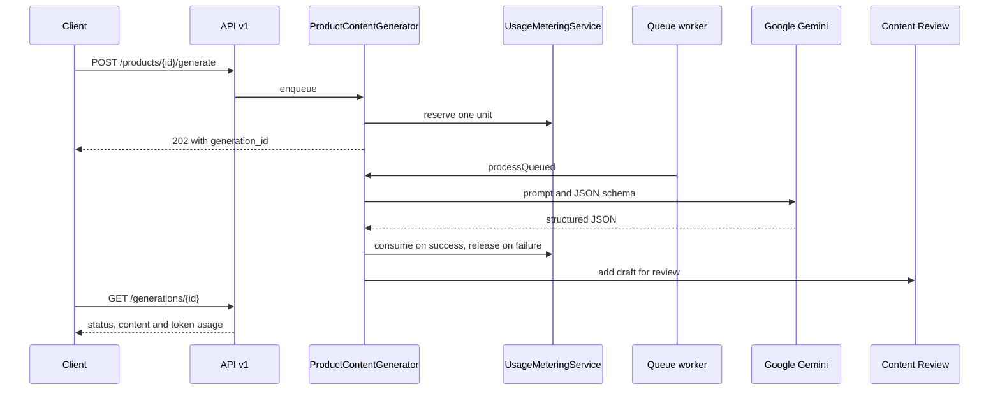

# Architecture

AI Product Studio is a server-rendered Laravel application using Blade and small vanilla JavaScript modules. Business rules live in services under `app/Services`, so the web app, REST API and queue jobs share them.

| Area | Location |
| --- | --- |
| AI generation and analysis | `app/Services/AI` |
| Prompts | `app/Services/AI/Prompts` |
| SEO and quality checks | `app/Services/AI/Quality` |
| Spreadsheet import and export | `app/Services/Catalog` |
| WooCommerce | `app/Services/WooCommerce` |
| Plans, usage and billing | `app/Services/Billing` |
| REST API | `app/Http/Controllers/Api/V1`, `routes/api.php` |
| Background work | `app/Jobs` |

The system diagram is in the [README](../../README.md#architecture).

## An API generation request

## Design decisions

**One path for AI results.** `ProductContentGenerator` owns quota checks, locking, prompts, validation and token tracking for the web app, bulk jobs and the API. A generation never writes product content. It produces a draft that a person approves, and replacing saved content needs explicit confirmation.

**Structured output, validated again.** Gemini receives a JSON schema, and its response is still validated against `ProductContentRules`, the same rules applied to reviewed forms. Invalid responses are discarded.

**Prompt boundaries.** Trusted rules go in the system instruction. Anything a user typed goes in the prompt as encoded, delimited data. Analysis keeps a SKU or material only if it appears in the user's own words.

**Deterministic checks where AI isn't needed.** SEO scoring is a rule-based checklist. It costs nothing, repeats exactly, and is explainable.

**Transports and providers.** `WooCommerceService` picks a real or demo transport for each store, and `BillingManager` picks a billing provider from server configuration. Everything above those boundaries is shared, so demo modes exercise the real workflow.

**Access decisions in one place.** `PlanEntitlementService` answers what a plan allows. Limits are enforced where work happens, such as `ProductService::create` and `WooCommerceService`, so a route or queue job can't avoid them.

**Concurrency handled in the database.** Monthly usage uses a conditional update under a per-user lock, and the product limit uses a locking read. Queue jobs claim work with conditional updates, so a retry can't repeat a Gemini call or a store write.

**Safe retries for clients.** `Idempotency-Key` replays the original response and rejects reuse with a different body. Keys are stored as hashes, and saved responses are encrypted.

**Isolation by construction.** `User::products()` excludes demo products, so they stay out of lists, statistics and exports without a check at each call. Lookups start from the owner's records, so another user's ID matches nothing.

**Store writes are guarded.** Only allowlisted descriptive fields can be sent. Each product is read again before writing, and a changed value stops as a conflict.

## Not in this architecture

Shopify and agency features aren't implemented. Their names appear only as reserved identifiers and as Coming Soon labels.
